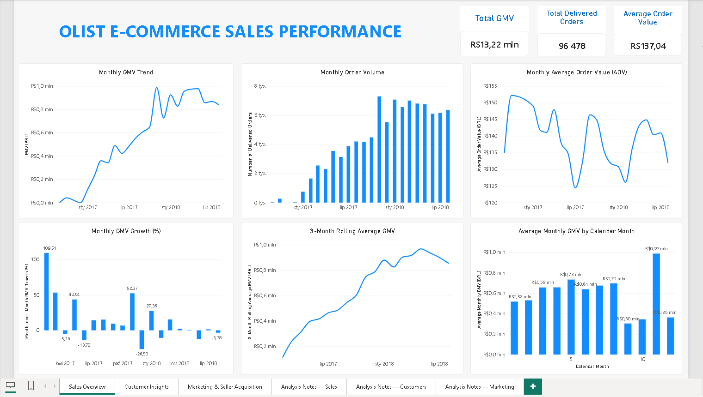
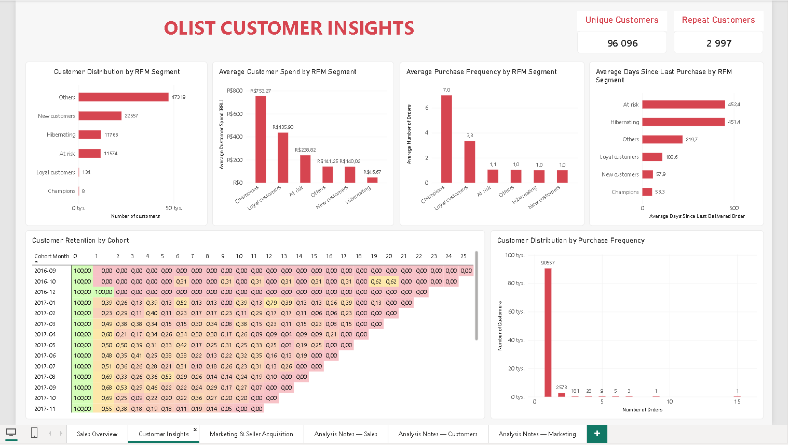
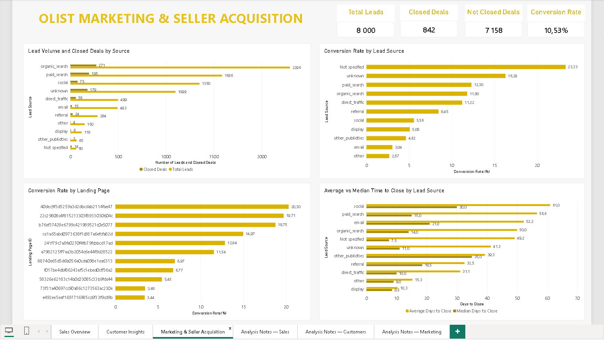

# Olist E-Commerce & Marketing Analytics

An end-to-end data analytics project combining **PostgreSQL** and **Power BI** to investigate Brazilian e-commerce marketplace performance, marketing lead conversion, seller acquisition, customer behaviour, retention, and revenue trends.

The project uses the Brazilian E-Commerce Public Dataset by Olist and the Marketing Funnel by Olist. SQL was used for data quality checks, business analysis, customer segmentation, and analytical view creation. The results were then presented in an interactive Power BI report.

---

## 1. Business Objectives

The analysis addresses the following business questions:

- How effectively are marketing leads converted into closed deals?
- Which marketing sources and landing pages generate the best conversion results?
- How many acquired sellers can be matched to marketplace activity?
- How concentrated is marketplace GMV among top-performing sellers?
- How frequently do customers return to the marketplace?
- How can customers be segmented based on their purchasing behaviour?
- How have marketplace sales and average order value evolved over time?

## 2. Tools & Technologies

- **PostgreSQL** – data querying, transformation, and analysis
- **SQL** – joins, CTEs, window functions, aggregations, cohort analysis, and RFM segmentation
- **pgAdmin 4** – PostgreSQL database management and query execution
- **Power BI Desktop** – interactive dashboards and data visualization

## 3. Project Structure

```text
Olist-Project/
│
├── data/
│   └── README.md
│
├── images/
│   ├── sales_overview.png
│   ├── customer_insights.png
│   └── marketing_seller_acquisition.png
│
├── sql/
│   ├── 01_data_quality.sql
│   ├── 02_marketing_funnel.sql
│   ├── 03_customer_cohort.sql
│   ├── 04_rfm_segmentation.sql
│   └── 05_revenue_trends.sql
│
├── Olist_Ecommerce_Marketing_Analytics.pbix
└── README.md
```

## 4. SQL Analysis

The SQL work is organized into five analytical modules.

### 4.1 Data Quality & Validation

- Checked missing values across key datasets.
- Identified duplicate lead IDs.
- Examined order status distributions.
- Validated relationships between orders, customers, sellers, and order items.
- Checked referential integrity and seller ID completeness.

### 4.2 Marketing Funnel & Seller Acquisition

- Calculated overall lead-to-closed-deal conversion.
- Compared conversion rates across lead sources.
- Evaluated landing page performance.
- Analyzed average and median time to close.
- Investigated declared monthly seller revenue and product catalog size.
- Matched acquired sellers to marketplace seller records.
- Evaluated seller-attributed delivered orders, GMV, and AOV.
- Compared the top 10 sellers with the remaining matched sellers.

### 4.3 Customer Cohort Analysis & Retention

- Calculated customer purchase history and cohort assignment.
- Analyzed monthly customer activity.
- Built a monthly cohort retention analysis.
- Created a retention matrix showing customer activity over time.
- Compared retention across different cohort ages.

### 4.4 RFM Customer Segmentation

Customers were evaluated using three dimensions:

- **Recency** – days since the most recent delivered order.
- **Frequency** – number of delivered orders.
- **Monetary** – total value of delivered order items, excluding freight.

Quartile-based scoring and custom frequency thresholds were used to create six customer segments:

- Champions
- Loyal Customers
- New Customers
- At Risk
- Hibernating
- Others

### 4.5 Revenue Trends & Seasonality

- Calculated monthly GMV, order volume, and Average Order Value (AOV).
- Analyzed month-over-month GMV growth.
- Created a three-month rolling average.
- Compared average GMV by calendar month to explore seasonality.

---

## 5. Power BI Dashboard

The SQL analysis is presented in an interactive Power BI report:

**`Olist_Ecommerce_Marketing_Analytics.pbix`**

The report contains three main analytical pages and three supplementary pages documenting analytical assumptions and methodology.

### 5.1 Sales Overview


Focuses on marketplace sales performance.

Key areas:
- GMV and order volume
- Average Order Value (AOV)
- Monthly revenue trends
- Month-over-month growth
- Rolling average
- Seasonality analysis

### 5.2 Customer Insights


Focuses on customer purchasing behaviour and retention.

Key areas:
- Customer purchase overview
- Repeat purchasing
- Cohort analysis
- Customer retention
- RFM customer segments

### 5.3 Marketing & Seller Acquisition


Focuses on lead generation, conversion, and seller marketplace performance.

Key areas:
- Marketing funnel performance
- Lead conversion by source
- Landing page performance
- Time to close
- Seller acquisition and marketplace activity
- GMV concentration among sellers

### 5.4 Analysis Notes

The report also includes three supplementary pages:

- Analysis Notes — Sales
- Analysis Notes — Customers
- Analysis Notes — Marketing

These pages explain important definitions, assumptions, and limitations behind the analysis.

---

## 6. Key Findings & Business Insights

### 6.1 Marketing Funnel

- Total marketing qualified leads (MQLs): **8,000**.
- Closed deals: **842**.
- Overall lead-to-closed-deal conversion rate: **10.53%**.
- Organic search generated the highest number of closed deals: **271**.
- Paid search generated **195** closed deals and achieved a slightly higher conversion rate than organic search (**12.30% vs. 11.80%**).
- The `unknown` lead source recorded the highest conversion rate among the analyzed sources (**16.29%**).
- Average time to close was **48.44 days**, while the median was **14 days**, indicating a right-skewed distribution.

### 6.2 Seller Marketplace Performance

- **380 out of 842** closed-deal sellers were matched to the marketplace sellers dataset (**45.13%**).
- Matched sellers generated **4,457 delivered orders**.
- Total delivered GMV amounted to **664,858.00**.
- Average Order Value was **149.17**.

The top 10 sellers represented only **2.63%** of matched sellers but generated **41.83%** of their total GMV.

Their AOV was **239.10**, compared with **117.21** for the remaining sellers — approximately **2.04 times higher**.

### 6.3 Customer Behaviour & Retention

- Total orders: **99,441**.
- Unique customers: **96,096**.
- Customers with more than one order: **2,997**.
- Approximately **3.12%** of unique customers placed more than one order.
- Month 1 retention remained below 1% across most cohorts.
- The highest observed Month 6 retention was **0.52%**.

The results indicate that repeat purchasing was relatively uncommon and that customer activity was not necessarily regular on a monthly basis.

### 6.4 RFM Segmentation

RFM analysis covered **93,358 customers** with at least one delivered order, using **August 30, 2018** as the reference date.

Customer segment distribution:

| Segment | Customers | Share |
|---|---:|---:|
| Others | 47,319 | 50.68% |
| New Customers | 22,557 | 24.16% |
| Hibernating | 11,766 | 12.60% |
| At Risk | 11,574 | 12.40% |
| Loyal Customers | 134 | 0.14% |
| Champions | 8 | 0.01% |

Approximately **25%** of analyzed customers belonged to the At Risk or Hibernating segments, suggesting an opportunity for customer reactivation campaigns.

### 6.5 Revenue Trends & Seasonality

- Monthly GMV, order volume, and AOV were analyzed for delivered orders from September 2016 to August 2018.
- November 2017 recorded the highest monthly GMV at approximately **R$987.8K**.
- Monthly GMV generally increased throughout 2017 and remained at a high level during the first half of 2018.
- Seasonality findings should be interpreted cautiously because of the limited observation period and incomplete months.

---

## 7. Methodological Notes & Limitations

- GMV is calculated as the sum of delivered order item prices, excluding freight. It does not represent Olist's profit or net revenue.
- Seller acquisition analysis uses matched seller IDs between the marketing funnel and marketplace datasets. The matched sellers represent a subset of all closed deals.
- Declared monthly seller revenue contains a high proportion of zero values, limiting its usefulness as a representative measure of seller revenue.
- Declared product catalog size has a high proportion of missing values.
- Cohort retention comparisons depend on the available observation period for each cohort.
- Small customer cohorts may produce volatile retention percentages.
- The RFM analysis uses August 30, 2018 as its reference date and includes delivered orders only.
- Seasonality analysis is limited by the available historical period and incomplete monthly observations.

---

## 8. Data Sources & Attribution

This project uses two publicly available datasets released by Olist:

1. **Brazilian E-Commerce Public Dataset by Olist**  
   https://www.kaggle.com/datasets/olistbr/brazilian-ecommerce

2. **Marketing Funnel by Olist**  
   https://www.kaggle.com/datasets/olistbr/marketing-funnel-olist

Both datasets are published under the **Creative Commons Attribution-NonCommercial-ShareAlike 4.0 International (CC BY-NC-SA 4.0)** license.

The datasets are provided by Olist and are used here for independent analytical and educational purposes.

The original data sources retain their respective attribution and licensing terms. Any redistribution of the datasets or adapted material must comply with the applicable license conditions.

This project is independent and is not affiliated with or endorsed by Olist.

---

## 9. How to Reproduce the Analysis

### Requirements

- PostgreSQL
- pgAdmin 4 (or another PostgreSQL client)
- Power BI Desktop

### Database Preparation

1. Download both datasets from the Kaggle sources listed above.
2. Import the required datasets into a PostgreSQL database.
3. Ensure the tables are available under the names expected by the SQL scripts, including:
   - `orders`
   - `order_items`
   - `customers`
   - `sellers`
   - `marketing_qualified_leads`
   - `closed_deals`

### Running the SQL Analysis

Open the SQL scripts in pgAdmin 4 and execute the analyses against the prepared database.

Recommended script order:

1. `01_data_quality.sql`
2. `02_marketing_funnel.sql`
3. `03_customer_cohort.sql`
4. `04_rfm_segmentation.sql`
5. `05_revenue_trends.sql`

The scripts contain validation queries, analytical queries, and SQL views used in the analysis.

### Opening the Power BI Report

1. Open `Olist_Ecommerce_Marketing_Analytics.pbix` in Power BI Desktop.
2. Configure the PostgreSQL data source connection if prompted.
3. Refresh the data if required.

The report can then be explored using its analytical pages and visualizations.

---

## 10. Project Scope

This project demonstrates an end-to-end analytical workflow:

**Raw Data → Data Quality Checks → PostgreSQL Analysis → Business Insights → Power BI Dashboard**

It combines SQL-based data analysis with business-oriented reporting to explore marketplace performance, customer behaviour, marketing effectiveness, and seller acquisition.